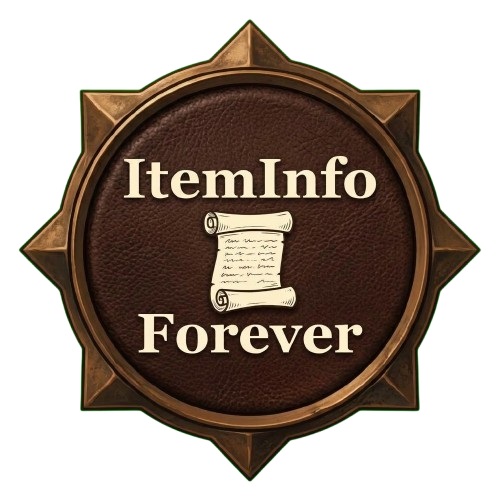
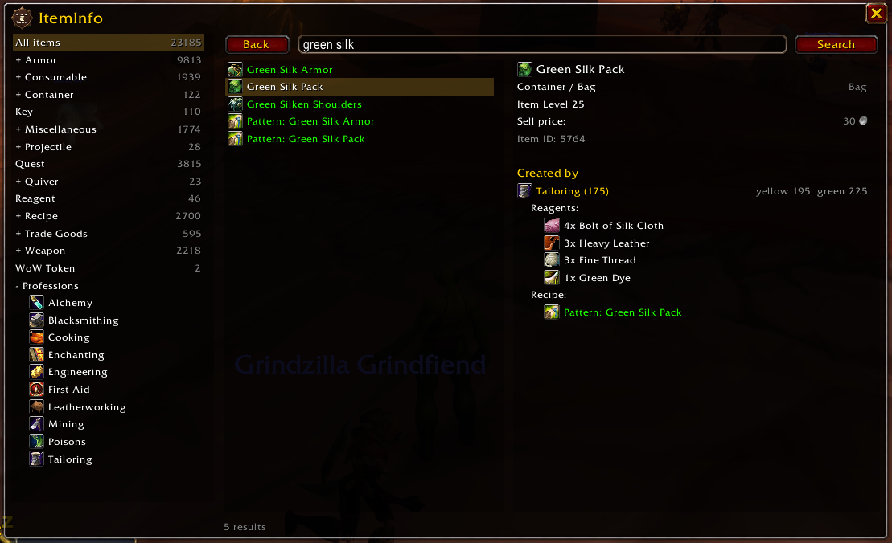
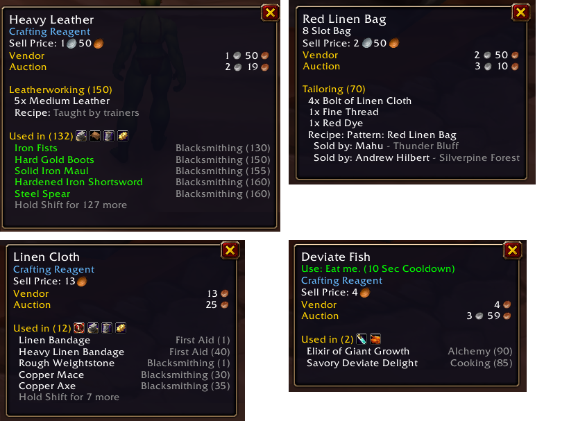
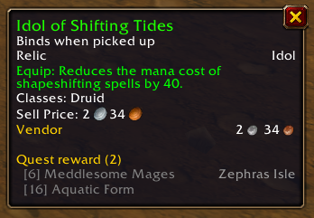
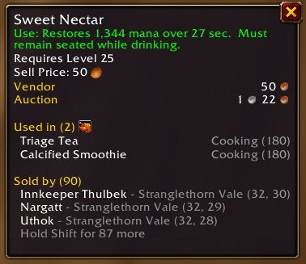
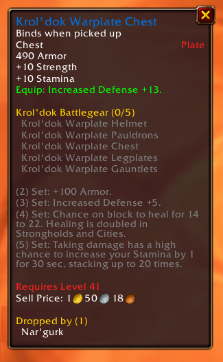
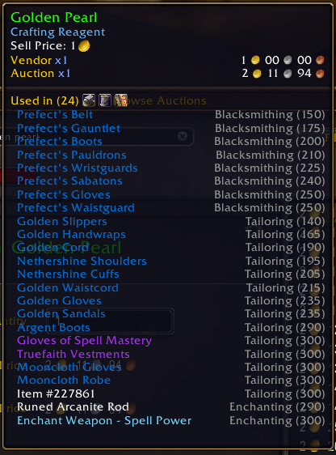
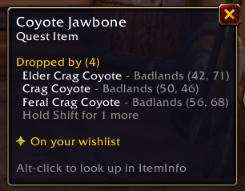
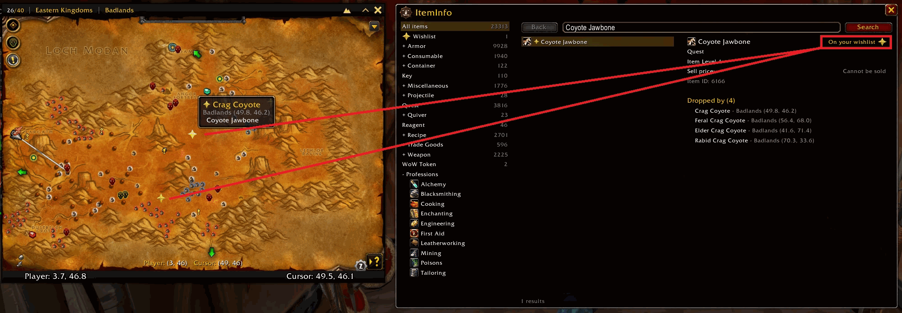

<p align="center"></p>

# ItemInfo

**An in-game item encyclopedia for World of Warcraft: Forever.**

Search every item in the game, see how it is crafted, what it is used for,
which recipe teaches it and who sells that recipe, in a window of its own and
in every item tooltip. No dependencies: the database ships with the addon.

## Features

### Encyclopedia window



- **Search every item.** Type any part of a name: `green` lists everything
  with "green" in it. Works in your client's language.
- **Browse by category.** A tree of the game's own item classes and
  subclasses, plus every profession with its recipes ordered by skill.
- **How it's made.** Profession, required skill, when the recipe turns
  yellow and green, reagents and the amount created.
- **Where the recipe comes from.** The recipe item, the vendors who sell it
  with their zone and coordinates, the creatures that drop it, or whether a
  trainer teaches it.
- **What it's used for.** Every recipe the item is a reagent of.
- **Quest rewards.** The quests that reward the item, with their level, zone
  and quest giver.
- **Prices.** What a vendor pays you for the item, and what a vendor charges
  for it once you have visited one.
- **Everything is a link.** Click a reagent, a product or a recipe to open
  it, *Back* returns. Shift-click links the item in chat.

### Item tooltips

Hover an item anywhere (bags, auction house, vendors, chat links) and its
tooltip gains:

- the profession and skill that make it, with the reagents,
- where to get the recipe, limited to vendors of your faction,
- the quests that reward it, with their level and zone,
- which vendors sell the item itself, the nearest first, with coordinates
  for those in your zone,
- which creatures drop it, or that it is a world drop,
- the recipes it is used in, with the icons of the professions involved.
  Hold **Shift** to unfold a long list.



The quests that reward an item, colored by difficulty:



The vendors of an item, the nearest first:



The creatures that drop an item:



Holding **Shift** unfolds the full list:



Turn it off with `/iteminfo tooltip` if you only want the window.

### What a creature drops

Hover a creature, or target it, and its tooltip lists the few items worth
knowing that it drops, out of what may be over a hundred:

- the items on your wishlist, always, marked with a star,
- then the three most notable: items few other creatures drop come first,
  being this creature's own loot, then better quality, recipes of your
  professions, and armor you can wear. Poor and common items are left out.
- Hold **Shift** to unfold up to fifteen. The look-up key (see below) opens
  every item the creature drops in the window, and so does `/iteminfo target`.

Choose what creature tooltips show with `/iteminfo creature`: `all` (the
default), `wishlist` (only items on your wishlist) or `off`.

### Wishlist

Click the star beside an item's name in the window to add it to the wishlist
of your character, the *Wishlist* category lists them. Then, out in the world:

- **Targeting a creature** that drops one of them tells you in chat, with a
  sound. A creature is announced again after five minutes at the earliest.
- **Opening a vendor** that sells one of them tells you as well.
- **Getting one** takes it off the list. Having some already is fine, the
  next one counts.

Turn the alerts off, or on again, with `/iteminfo alerts`.

An item on the wishlist says so in its tooltip:



The world map shows a star where each creature that drops an item on your
wishlist is, on its zone's map and on the continent's, so you know where to
go. Hover a star for the creature and its items. The data knows one spawn
point per creature, a star tells roughly where it is. `/iteminfo map` shows
or hides the stars.



### Look up any item in one click

- **Alt-click** an item anywhere: bags, bank, loot, vendors, the auction
  house, chat links. The window opens with its name searched and its details
  shown, how to get its recipe included. Pick another modifier, or turn it
  off, with `/iteminfo click`.
- **A key of your own.** Bind *Look up the item under the mouse* in the
  game's key bindings (AddOns, ItemInfo) and press it while hovering an item.
  A gamepad button works too. Over a creature, it lists every item the
  creature drops. With neither under the mouse, it opens or closes the window.
- **Shift-click into the search box.** While the search box has focus, a
  shift-click on an item fills it in, as the auction house's does.

### Item database

- Scanned from your client in the background on first login; items found so
  far are searchable while it runs. It pauses in combat and resumes after a
  logout.
- Scanned again by itself only after a game patch. Otherwise it is updated
  when you ask for it, and items you come across in game are added right away.
- On every login, ItemInfo reports the state of the database in chat.

### What's new

After an update, a page tells once what the new version brings. It is not
shown on a fresh install, nor in combat, and `/iteminfo news` brings it back.

### Update notice

Addons cannot reach the internet, so ItemInfo compares versions with the
other ItemInfo users of your guild and group. When one of them has a newer
version, a single line in chat tells you so.

## Installation

1. Download the latest release, or this repository.
2. Copy the `ItemInfo` folder into
   `World of Warcraft/_forever_/Interface/AddOns/`.
3. Restart the game. The first scan starts a few seconds after login.

## Usage

Click the book icon on the minimap, or use a command:

| Command | |
| --- | --- |
| `/iteminfo` or `/ii` | Open or close the window |
| `/iteminfo <name>` | Search, and open the item if the name is exact |
| `/iteminfo <link or ID>` | Open an item |
| `/iteminfo update` | Look for items missing from the database |
| `/iteminfo rebuild` | Rebuild the item database from scratch |
| `/iteminfo tooltip` | Show or hide the crafting info in item tooltips |
| `/iteminfo minimap` | Show or hide the minimap button |
| `/iteminfo click <modifier>` | The modifier of a look-up click: `alt` (default), `ctrl-alt`, `shift-alt` or `off` |
| `/iteminfo creature <mode>` | What creature tooltips show: `all` (default), `wishlist` or `off` |
| `/iteminfo target` | List every item your target drops |
| `/iteminfo wishlist` | Open your wishlist |
| `/iteminfo alerts` | Turn the wishlist alerts on or off |
| `/iteminfo map` | Show or hide the wishlist stars on the world map |
| `/iteminfo news` | Show what is new in this version |
| `/iteminfo help` | List the commands |

Other addons and macros can call `ItemInfo.Toggle()`, `ItemInfo.Search(text)`,
`ItemInfo.ShowItem(itemId)`, `ItemInfo.LookUpHovered()`,
`ItemInfo.ShowWishlist()` and `ItemInfo.ToggleWishlist(itemId)`.

## Languages

Item, spell, profession and zone names come from the game client, so they are
always in your language, and each language keeps an item database of its own.

The interface is translated to German, French, Spanish, Portuguese, Italian,
Russian, Korean, Simplified and Traditional Chinese. Vendor names are
localized for the same languages. To add or fix a translation, edit
`ItemInfo/Locales/Locales.lua`.

## Known limits

- Items that are hidden until they first drop on your server cannot be
  scanned. Run `/iteminfo update` to look for them again.
- Enchants are listed by their spell, since they create no item.
- The skill at which a recipe turns yellow and green is unknown for the
  recipes that are new in Forever.
- What a vendor charges is not part of the shipped data, it is recorded when
  you open a vendor.
- Drop chances are not part of the data, a creature's tooltip tells what it
  can drop, not how often. Creatures new in Forever are not known yet.

## Development

```
ItemInfo/        the addon
  Core/          scanner, lookups, tooltips, slash commands
  UI/            window, lists, minimap button
  Data/          generated recipe, vendor, NPC and quest data
  Locales/       interface translations
  Media/         logo
tools/           data generator
tests/           offline test harness
```

`tools/gen_data.py` regenerates `ItemInfo/Data` from a local AddOns folder
that holds AtlasLootContinued and QuestieDB. `tests/harness.py` loads the
addon in Lua 5.1 against a stubbed WoW API with a simulated item server, and
runs a scenario over the scan, the search, the window and the tooltips:

```sh
pip install cbor2 lupa
python3 tools/gen_data.py "<path to Interface/AddOns>" ItemInfo/Data
python3 tests/harness.py          # enUS
python3 tests/harness.py deDE     # any other locale
```

## Releasing

Releases are built by the [BigWigs packager](https://github.com/BigWigsMods/packager)
on GitHub Actions and uploaded to CurseForge and GitHub:

```sh
git tag -a v1.0.0 -m "v1.0.0"
git push origin v1.0.0
```

A release with news for the players adds an entry on top of `NOTES` in
`ItemInfo/UI/WhatsNew.lua`, with its texts in `ItemInfo/Locales/Locales.lua`.
Players who have not seen the newest entry get the page once.

A tag containing `beta` or `alpha` (`v1.0.0-beta1`) is published as such. The
tests run first, a failing test stops the release. The version in the TOC is
filled in from the tag, and the changelog from the commits since the last tag.

One-time setup:

1. Add `## X-Curse-Project-ID: <id>` to `ItemInfo/ItemInfo.toc`, the ID is on
   the project's CurseForge page.
2. Create a [CurseForge API token](https://authors.curseforge.com/#/settings/api-tokens)
   and save it as the repository secret `CF_API_TOKEN`.

## Credits and license

ItemInfo is released under the GPL-2.0, see `ItemInfo/LICENSE`.

- Recipe data is derived from **AtlasLootClassic** (GPL-2.0).
- Vendor, drop, NPC and quest data is derived from **QuestieDB**.
- The item scan is adapted from **ItemAutocomplete** by Elliott Linder (MIT).

The details are in `ItemInfo/NOTICE.md`.
