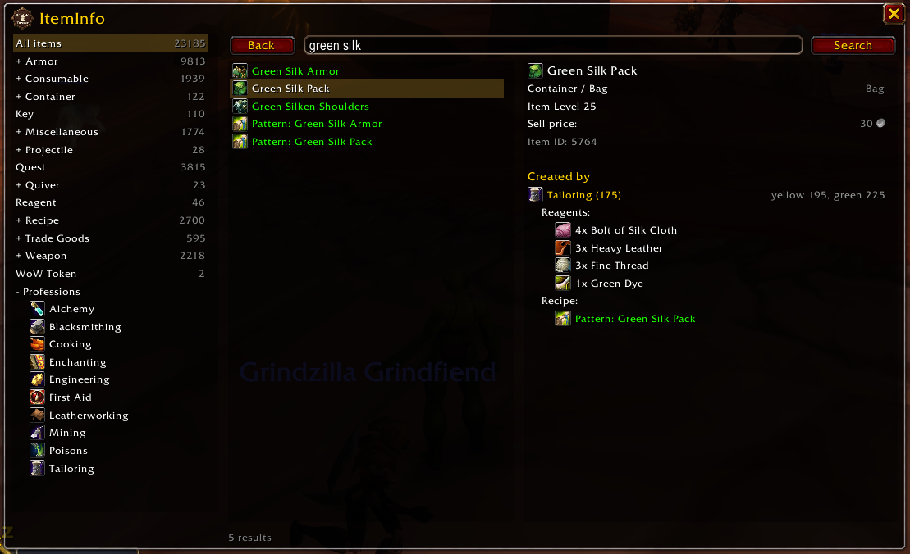
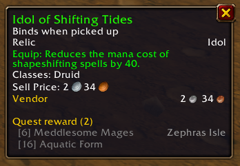
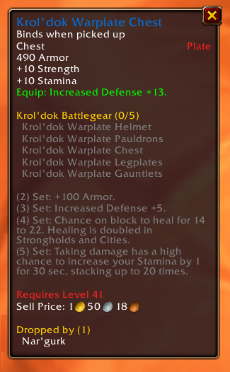
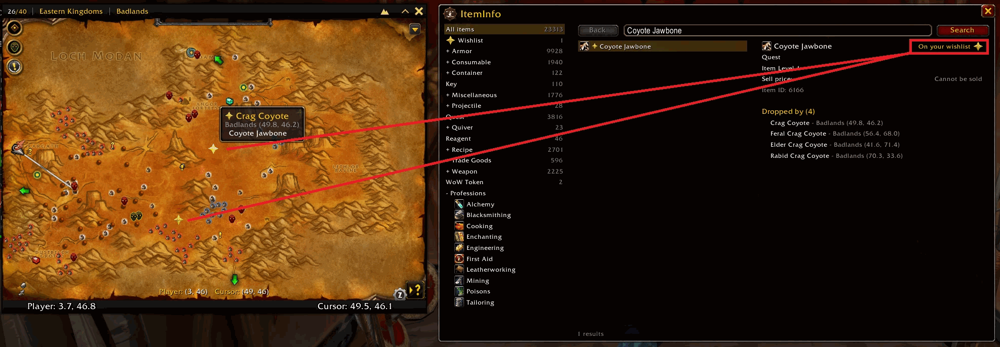
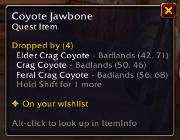

# ItemInfo

**An in-game item encyclopedia for World of Warcraft: Forever.**

Ever held a stack of Mystery Meat and wondered what it's good for? Or wanted to know at which Tailoring skill you can make a bag, and who sells the pattern? ItemInfo answers that without leaving the game: in a searchable window, and right in the item's tooltip.

It has **no dependencies**. The database ships with the addon.

## What it does

### A searchable encyclopedia

Open it from the minimap button or with `/iteminfo`.

- **Search every item** by any part of its name. `/iteminfo green` lists everything with "green" in it.
- **Browse by category:** the game's own item classes and subclasses, plus every profession with its recipes sorted by skill.
- **How it's made:** profession, required skill, when it turns yellow and green, reagents, and how many you get.
- **Where the recipe comes from:** the recipe item, which vendors sell it (with zone and coordinates), which creatures drop it, or whether a trainer teaches it.
- **What it's used for:** every recipe the item is a reagent of.
- **Quest rewards:** the quests that reward the item, with their level, zone and quest giver.
- **Prices:** what a vendor pays you, and what a vendor charges once you have visited one.
- **Everything is clickable:** jump from an item to its reagents, from a reagent to what else it makes, and back. Shift-click links the item in chat.

### Crafting info in every tooltip

Hover an item in your bags, at the auction house, at a vendor or in chat, and the tooltip also shows:

- for a recipe: **do you know it already?** Or can you learn it now, or at which skill? The same for your alts on the realm,
- the profession and skill that make it, with its reagents,
- where to get the recipe, limited to vendors of your faction,
- for a mage's undeciphered scroll, the scrolls it may turn into, and the other way around,
- the quests that ask for it, those in your quest log first,
- the quests that reward it, with their level and zone,
- which vendors sell the item itself, the nearest first, with coordinates for those in your zone,
- which creatures drop it, or that it is a world drop, with the drop rate of dungeon and raid bosses,
- what it is used in, with the icons of the professions involved. Hold **Shift** to unfold a long list.

The quests that reward an item, colored by difficulty:

The vendors of an item, the nearest first:

The creatures that drop an item:

Holding **Shift** unfolds the full list:

Only want the window? `/iteminfo tooltip` turns the tooltip part off.

Open each profession window once on every character, and ItemInfo remembers the recipes it knows.

### What a creature drops

Hover or target a creature and its tooltip lists the few items worth knowing that it drops, even when it drops over a hundred: what your quests ask for first, then its own loot, better quality, recipes of your professions you don't know yet and armor you can wear. Bosses show the drop rate of each item. Junk is left out. Hold **Shift** for more, or press the look-up key over the creature (or type `/iteminfo target`) to see everything it drops in the window.

`/iteminfo creature all`, `wishlist` or `off` chooses what creature tooltips show.

### A wishlist that helps you find things

Click the star beside an item's name in the window to put it on your character's wishlist.

- **Stars on the world map** show where the creatures that drop your wishlist items are, every place they roam on the zone's map, and on the continent's. Hover one to see the creature and its items.
- **Crafted items:** each reagent's tooltip shows how many you have out of how many it takes, and the chat tells you as you loot more, and when you have them all.
- **Targeting a creature** that drops one of them tells you in chat, with a sound.
- **Opening a vendor** that sells one of them tells you too.
- **Getting one** takes it off the list.

The item's tooltip tells it is on your wishlist:

### Look up any item in one click

Found an ingredient and want to know what it makes, or how to get its recipe? No need to type its name:

- **Alt-click** the item in your bags, the bank, the loot window, at a vendor, at the auction house or in chat, and ItemInfo opens on it. Prefer another modifier? `/iteminfo click ctrl-alt`, `shift-alt` or `off`.
- **Bind a key**, or a gamepad button, to *Look up the item under the mouse* in the game's key bindings (AddOns, ItemInfo), and press it while hovering an item.
- **Shift-click into the search box:** while it has focus, a shift-click on an item fills it in, just like the auction house.

### A database that looks after itself

- Scans the client's items in the background on first login. You can search while it runs; it pauses in combat and resumes after a logout.
- Scans again by itself only after a game patch. Items you come across in game are added right away.
- Tells you the state of the database on every login.
- Tells you when a newer version is out, learnt from the other ItemInfo users in your guild and group.
- After an update, shows once what the new version brings.

## Commands

- `/iteminfo` or `/ii` - open or close the window
- `/iteminfo <name>` - search, and open the item if the name is exact
- `/iteminfo <link or ID>` - open an item
- `/iteminfo update` - look for items missing from the database
- `/iteminfo rebuild` - rebuild the item database from scratch
- `/iteminfo tooltip` - show or hide the crafting info in tooltips
- `/iteminfo minimap` - show or hide the minimap button
- `/iteminfo click <modifier>` - the modifier of a look-up click: `alt` (default), `ctrl-alt`, `shift-alt` or `off`
- `/iteminfo creature <mode>` - what creature tooltips show: `all` (default), `wishlist` or `off`
- `/iteminfo target` - list every item your target drops
- `/iteminfo wishlist` - open your wishlist
- `/iteminfo alerts` - turn the wishlist alerts on or off
- `/iteminfo map` - show or hide the wishlist stars on the world map
- `/iteminfo news` - show what is new in this version

## Languages

Item, spell, profession and zone names always appear in your client's language. The interface itself is translated to German, French, Spanish, Portuguese, Italian, Russian, Korean, Simplified and Traditional Chinese.

## Good to know

- Items that are hidden until they first drop on your server can't be scanned yet. `/iteminfo update` looks for them again.
- Enchants are listed by their spell, since they create no item.
- Vendor buy prices are recorded when you open a vendor; they are not part of the shipped data.
- Drop chances are not part of the data: a creature's tooltip tells what it can drop, not how often. A map star marks one spawn point of a creature, roughly where it is.
- Which scroll a mage deciphers is up to the server: the scrolls listed are the possible ones, as gathered by players, and may be incomplete.
- Replaces a separate profession tooltip addon. If you run one alongside, the same info shows twice.

## Credits

Recipe data is derived from AtlasLootClassic (GPL-2.0), vendor, NPC and quest data from QuestieDB, and the item scan is adapted from ItemAutocomplete by Elliott Linder (MIT). ItemInfo is released under the GPL-2.0.

Found a bug or a missing recipe? Open an issue on GitHub: https://github.com/simsekahmett/iteminfo-forever
