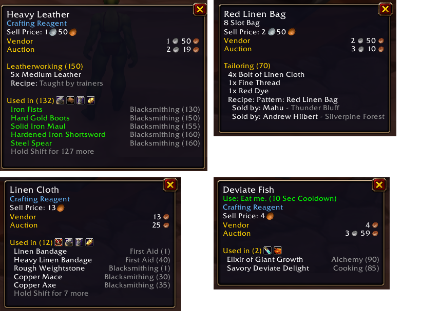
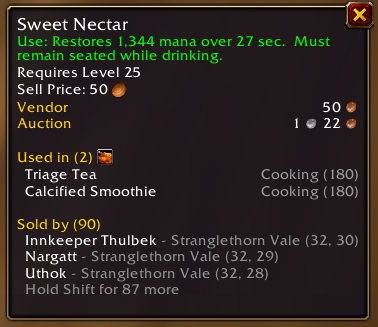
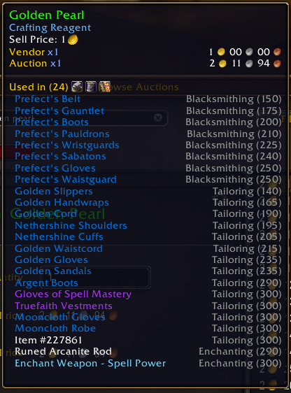

# ItemInfo

**An in-game item encyclopedia for World of Warcraft: Forever.**

Ever held a stack of Mystery Meat and wondered what it's good for? Or wanted to know at which Tailoring skill you can make a bag, and who sells the pattern? ItemInfo answers that without leaving the game: in a searchable window, and right in the item's tooltip.

It has **no dependencies**. The database ships with the addon.

## What it does

### A searchable encyclopedia

Open it from the minimap button or with `/iteminfo`.

- **Search every item** by any part of its name. `/iteminfo green` lists everything with "green" in it.
- **Browse by category:** the game's own item classes and subclasses, plus every profession with its recipes sorted by skill.
- **How it's made:** profession, required skill, when it turns yellow and green, reagents, and how many you get.
- **Where the recipe comes from:** the recipe item, which vendors sell it (with zone and coordinates), which creatures drop it, or whether a trainer teaches it.
- **What it's used for:** every recipe the item is a reagent of.
- **Prices:** what a vendor pays you, and what a vendor charges once you have visited one.
- **Everything is clickable:** jump from an item to its reagents, from a reagent to what else it makes, and back. Shift-click links the item in chat.

### Crafting info in every tooltip

Hover an item in your bags, at the auction house, at a vendor or in chat, and the tooltip also shows:

- the profession and skill that make it, with its reagents,
- where to get the recipe, limited to vendors of your faction,
- which vendors sell the item itself, the nearest first, with coordinates for those in your zone,
- what it is used in, with the icons of the professions involved. Hold **Shift** to unfold a long list.

The vendors of an item, the nearest first:

Holding **Shift** unfolds the full list:

Only want the window? `/iteminfo tooltip` turns the tooltip part off.

### A database that looks after itself

- Scans the client's items in the background on first login. You can search while it runs; it pauses in combat and resumes after a logout.
- Scans again by itself only after a game patch. Items you come across in game are added right away.
- Tells you the state of the database on every login.

## Commands

- `/iteminfo` or `/ii` - open or close the window
- `/iteminfo <name>` - search, and open the item if the name is exact
- `/iteminfo <link or ID>` - open an item
- `/iteminfo update` - look for items missing from the database
- `/iteminfo rebuild` - rebuild the item database from scratch
- `/iteminfo tooltip` - show or hide the crafting info in tooltips
- `/iteminfo minimap` - show or hide the minimap button

## Languages

Item, spell, profession and zone names always appear in your client's language. The interface itself is translated to German, French, Spanish, Portuguese, Italian, Russian, Korean, Simplified and Traditional Chinese.

## Good to know

- Items that are hidden until they first drop on your server can't be scanned yet. `/iteminfo update` looks for them again.
- Enchants are listed by their spell, since they create no item.
- Vendor buy prices are recorded when you open a vendor; they are not part of the shipped data.
- Replaces a separate profession tooltip addon. If you run one alongside, the same info shows twice.

## Credits

Recipe data is derived from AtlasLootClassic (GPL-2.0), vendor and NPC data from QuestieDB, and the item scan is adapted from ItemAutocomplete by Elliott Linder (MIT). ItemInfo is released under the GPL-2.0.

Found a bug or a missing recipe? Open an issue on GitHub: https://github.com/simsekahmett/iteminfo-forever
